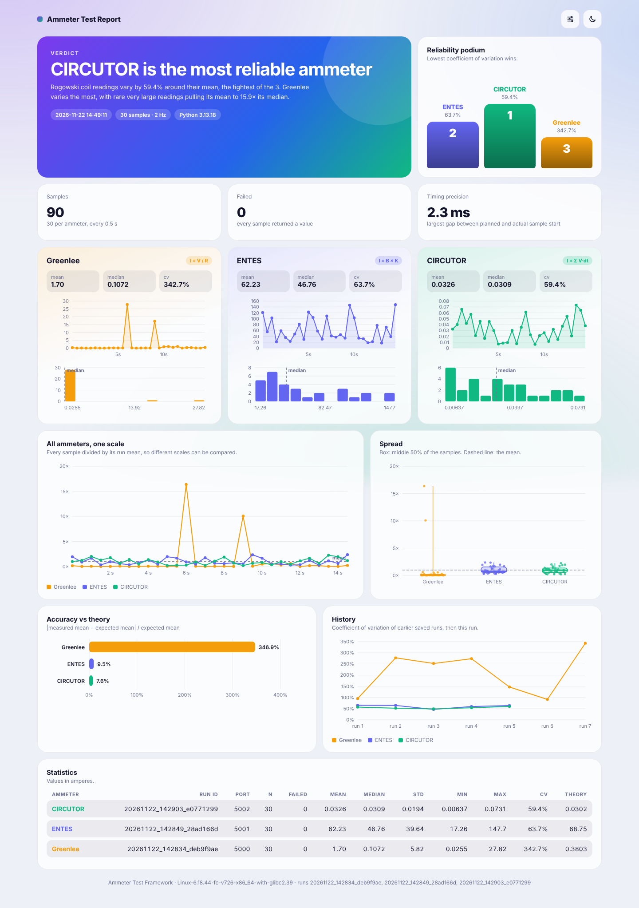
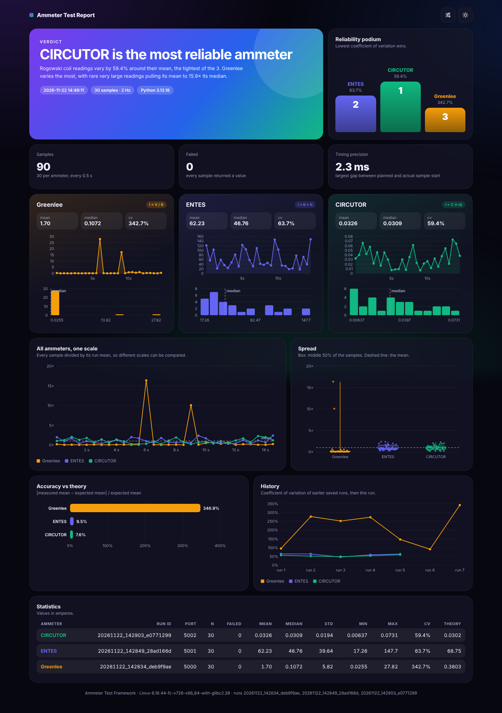
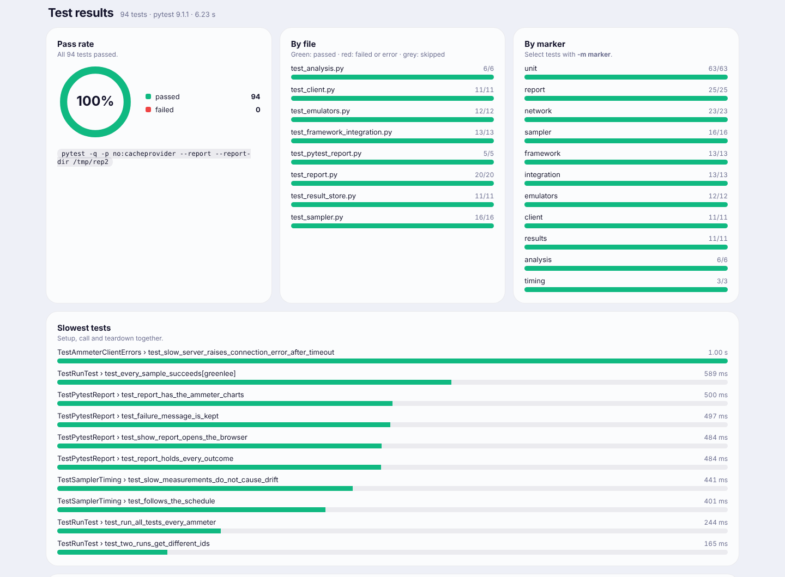
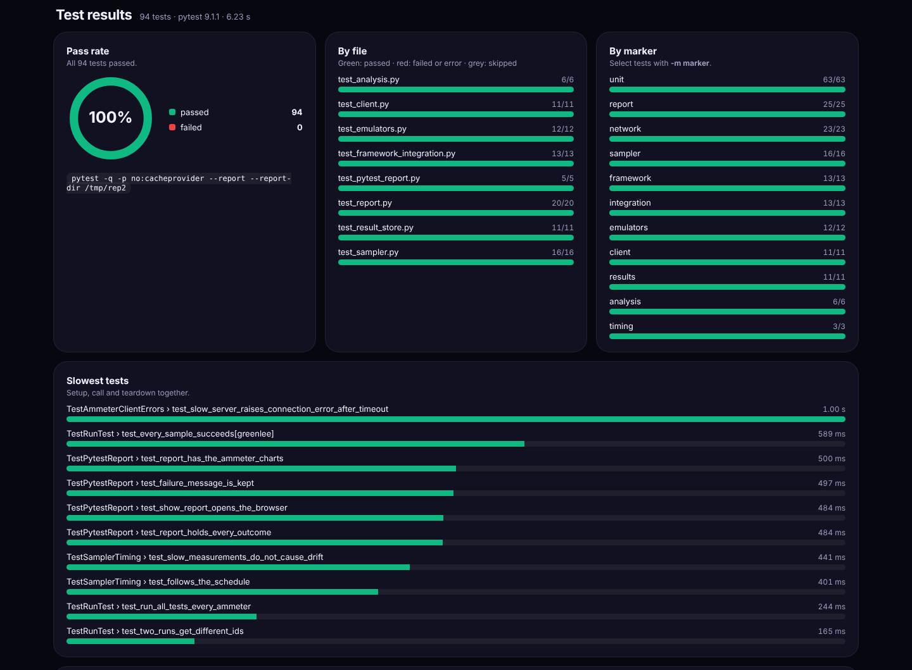
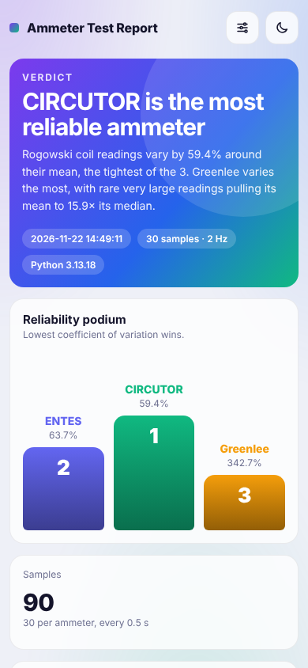
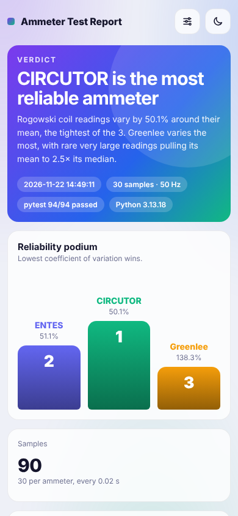
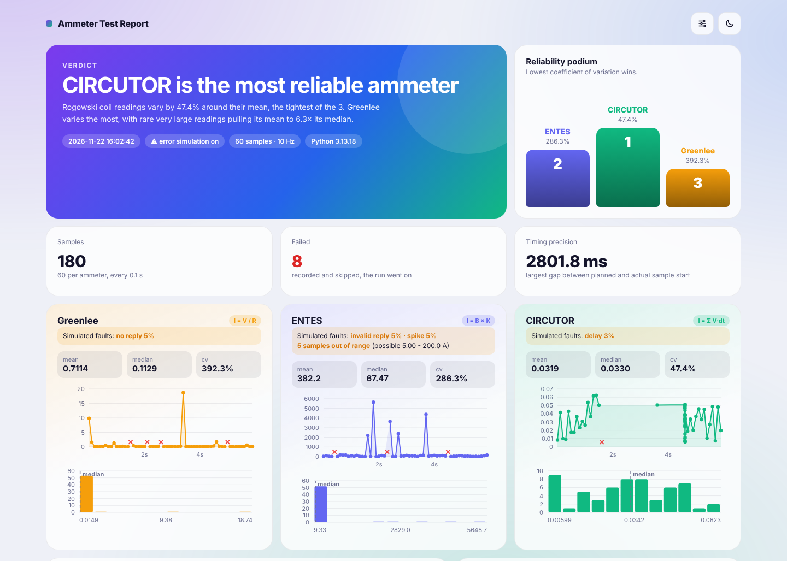
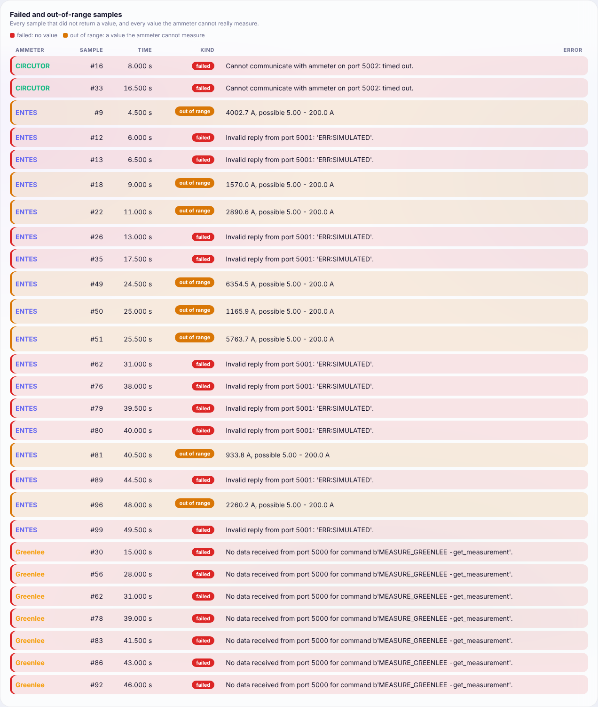
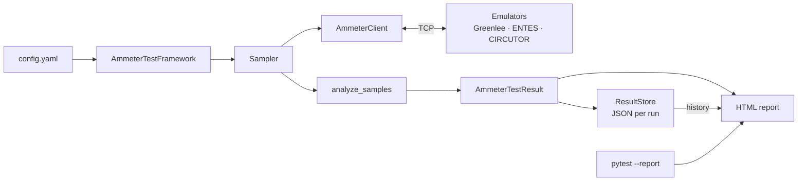

<h1 id="ammeter-test-framework">⚡ Ammeter Test Framework</h1>

  
  
  
  
  
  

  

<!-- Table of Contents -->
<h2>Table of Contents</h2>
<ul>
  <li><a href="#overview">Overview</a></li>
  <li><a href="#technologies-used">Technologies Used</a></li>
  <li><a href="#requirements">Requirements</a></li>
  <li><a href="#installation">Installation</a>
    <ul>
      <li><a href="#ide-setup">🛠 IDE Setup (Recommended)</a></li>
      <li><a href="#virtual-environment">📦 Virtual Environment and Dependencies</a></li>
    </ul>
  </li>
  <li><a href="#the-ammeters">The Ammeters</a></li>
  <li><a href="#running-the-ammeter-tests">▶️ Running the Ammeter Tests</a></li>
  <li><a href="#html-report">📊 HTML Report</a>
    <ul>
      <li><a href="#report-commands">🔧 Report Commands</a></li>
      <li><a href="#ammeter-charts">📈 Ammeter Charts</a></li>
      <li><a href="#test-results-in-the-report">🧪 Test Results in the Report</a></li>
    </ul>
  </li>
  <li><a href="#error-simulation">🧨 Error Simulation</a></li>
  <li><a href="#running-the-test-suite">🧪 Running the Test Suite</a>
    <ul>
      <li><a href="#basic-test-execution">🔧 Basic Test Execution</a></li>
      <li><a href="#pytest-markers">🎯 Pytest Markers</a></li>
      <li><a href="#run-specific-tests">🧪 Run Specific Test Files and Classes</a></li>
    </ul>
  </li>
  <li><a href="#types-of-tests">Types of Tests</a></li>
  <li><a href="#configuration">⚙️ Configuration</a></li>
  <li><a href="#using-the-framework-from-code">Using the Framework from Your Own Code</a></li>
  <li><a href="#results-and-logs">📁 Results and Logs</a></li>
  <li><a href="#project-structure">📁 Project Structure and Architecture</a></li>
  <li><a href="#design-decisions">💡 Design Decisions</a></li>
  <li><a href="#fixes-to-the-existing-code">🐞 Fixes to the Existing Code</a></li>
  <li><a href="#libraries-installed">📚 Libraries Installed</a></li>
</ul>

<h2 id="overview">Overview</h2>

  The Ammeter Test Framework tests three emulated current meters, Greenlee, ENTES and CIRCUTOR.
  Each emulator is a small TCP server that answers a measurement command with a current value, the way a real
  ammeter connected to an embedded board would. The framework samples every ammeter on a precise schedule,
  analyzes the readings, archives every run, compares the ammeters with each other and with theory, and
  shows everything in an interactive HTML report.

<h3 id="purpose-of-the-project">Purpose of the Project</h3>
<ul>
  <li><b>Unified measurement API:</b> one call, <code>run_test('greenlee')</code>, tests any ammeter in the config and returns the same result type for all of them.</li>
  <li><b>Precise sampling:</b> configurable number of samples, duration and frequency. Samples run on an absolute time grid, so slow replies never add up to drift.</li>
  <li><b>Result analysis:</b> mean, median, standard deviation, minimum, maximum and coefficient of variation.</li>
  <li><b>Result management:</b> a unique id for every run, metadata, one JSON file per run, loading by id and side by side comparison of historical runs.</li>
  <li><b>Accuracy assessment:</b> the measured mean is compared with the mean predicted by each formula, and the ammeters are ranked by consistency.</li>
  <li><b>Visual report:</b> a self-contained HTML page with charts, light and dark mode and selectable tiles, for <code>main.py</code> and for pytest.</li>
  <li><b>Configuration-driven:</b> ports, commands, sampling, report and logging all come from <code>config/config.yaml</code>.</li>
  <li><b>Error handling:</b> a custom exception for every failure type. A failed sample is recorded and the run goes on.</li>
  <li><b>Error simulation:</b> the emulators can fail on purpose (no reply, invalid reply, late reply, wrong value) to prove that the framework copes.</li>
</ul>

<h2 id="technologies-used">Technologies Used</h2>
<table>
  <thead> <tr> <th>Icon</th> <th>Technology</th> <th>Description</th> </tr> </thead>
  <tbody>
    <tr>
      <td></td>
      <td><strong>Python 3.10+</strong></td>
      <td>Core programming language</td>
    </tr>
    <tr>
      <td></td>
      <td><strong>pytest</strong></td>
      <td>Test runner, fixtures, markers and the <code>--report</code> plugin</td>
    </tr>
    <tr>
      <td></td>
      <td><strong>PyYAML</strong></td>
      <td>Reads <code>config/config.yaml</code></td>
    </tr>
    <tr>
      <td></td>
      <td><strong>socket, threading</strong></td>
      <td>The emulators run as TCP servers in background threads (standard library)</td>
    </tr>
    <tr>
      <td></td>
      <td><strong>statistics</strong></td>
      <td>Mean, median and standard deviation without numpy (standard library)</td>
    </tr>
    <tr>
      <td></td>
      <td><strong>HTML, SVG, JavaScript</strong></td>
      <td>The report: charts drawn by a small built-in script, no chart library and no internet needed</td>
    </tr>
  </tbody>
</table>

<h2 id="requirements">Requirements</h2>
<table>
  <thead>
    <tr>
      <th>Icon</th>
      <th>Requirement</th>
      <th>Description</th>
    </tr>
  </thead>
  <tbody>
    <tr>
      <td></td>
      <td><strong>Python 3.10+</strong></td>
      <td>Required to run the framework and the tests</td>
    </tr>
    <tr>
      <td></td>
      <td><strong>pip</strong></td>
      <td>Installs the two dependencies from <code>requirements.txt</code></td>
    </tr>
    <tr>
      <td></td>
      <td><strong>Free local ports</strong></td>
      <td>Ports 5000, 5001 and 5002 on <code>localhost</code> for <code>main.py</code>. The pytest suite picks free ports by itself</td>
    </tr>
    <tr>
      <td></td>
      <td><strong>Web browser</strong></td>
      <td>To open the HTML report</td>
    </tr>
  </tbody>
</table>

<h2 id="installation">Installation</h2>

<h3 id="ide-setup">🛠 IDE Setup (Recommended)</h3>

  A modern Python IDE such as <strong>PyCharm</strong> or <strong>VS Code</strong> makes the work easier: it finds the
  virtual environment, runs single tests from the editor and shows the markers.

<h4>💡 Why PyCharm?</h4>
<ul>
  <li>Automatic virtual environment detection</li>
  <li>Built-in inspections that catch mistakes early</li>
  <li>Native pytest support: test discovery, markers, run and debug from the gutter icon</li>
  <li>A built-in terminal that opens with the virtual environment already active</li>
</ul>
<h4>PyCharm setup</h4>
<ol>
  <li>Open PyCharm, select <strong>Open</strong> and choose the project folder (<code>Test_QA_expanded</code>).</li>
  <li>Create the virtual environment as shown in the next section.</li>
  <li>Set the Python interpreter:
    <ul>
      <li>Go to <strong>File → Settings → Project → Python Interpreter</strong></li>
      <li>Select <strong>Add Interpreter → Add Local Interpreter → Existing</strong></li>
      <li>Point to the Python of the virtual environment:
        <pre><code>.venv\Scripts\python.exe</code></pre>
        or on Linux / macOS:
        <pre><code>.venv/bin/python</code></pre>
      </li>
    </ul>
  </li>
  <li>Enable pytest:
    <ul>
      <li>Go to <strong>Settings → Tools → Python Integrated Tools</strong></li>
      <li>Under “Testing → Default test runner”, select <strong>pytest</strong></li>
    </ul>
  </li>
</ol>

  If PyCharm reports <code>No module named 'yaml'</code>, the interpreter is not the one of the virtual environment. Repeat step 3.

<h3 id="virtual-environment">📦 Virtual Environment and Dependencies</h3>

All commands run from the project root.

<ol>
  <li>
    Go to the project folder:
    <pre><code>cd Test_QA_expanded</code></pre>
  </li>

  <li>
    Create the virtual environment (once):
    <pre><code>python -m venv .venv</code></pre>
  </li>

  <li>
    Activate it (every new terminal):
     <strong>Windows, Command Prompt:</strong>
    <pre><code>.venv\Scripts\activate.bat</code></pre>
    <strong>Windows, PowerShell:</strong>
    <pre><code>.venv\Scripts\Activate.ps1</code></pre>
    <strong>Linux / macOS:</strong>
    <pre><code>source .venv/bin/activate</code></pre>
    When it is active, the prompt starts with <code>(.venv)</code>.
    If PowerShell answers <code>running scripts is disabled on this system</code>, use the Command Prompt instead.
  </li>

  <li>
    Install the dependencies:
    <pre><code>python -m pip install --upgrade pip
pip install -r requirements.txt</code></pre>
  </li>

  <li>
    Check the installation:
    <pre><code>python -m pytest --version
python -c "import yaml; print('OK')"</code></pre>
  </li>

  <li>
    Leave the virtual environment when you are done:
    <pre><code>deactivate</code></pre>
  </li>
</ol>

<h2 id="the-ammeters">The Ammeters</h2>
<table>
  <thead>
    <tr> <th>Ammeter</th> <th>Port</th> <th>Command</th> <th>Method</th> <th>Formula</th> <th>Possible current</th> </tr>
  </thead>
  <tbody>
    <tr>
      <td><strong>🟠 Greenlee</strong></td> <td>5000</td> <td><code>MEASURE_GREENLEE -get_measurement</code></td>
      <td>Ohm's law</td> <td>I = V / R V 1-10 V, R 0.1-100 Ω</td> <td>0.01 - 100 A</td>
    </tr>
    <tr>
      <td><strong>🟣 ENTES</strong></td> <td>5001</td> <td><code>MEASURE_ENTES -get_data</code></td>
      <td>Hall effect</td> <td>I = B × K B 0.01-0.1 T, K 500-2000</td> <td>5 - 200 A</td>
    </tr>
    <tr>
      <td><strong>🟢 CIRCUTOR</strong></td> <td>5002</td> <td><code>MEASURE_CIRCUTOR -get_measurement</code></td>
      <td>Rogowski coil</td> <td>I = Σ V·dt 10 samples, V 0.1-1.0 V, dt 0.001-0.01 s</td> <td>0.001 - 0.1 A</td>
    </tr>
  </tbody>
</table>

  Each emulator answers its exact command with one value and closes the connection. Any other command is ignored by the
  emulator, logged as a warning, and reported by the client as an error.

<h2 id="running-the-ammeter-tests">▶️ Running the Ammeter Tests</h2>

  <code>main.py</code> starts the three emulators, samples each of them, prints a summary, saves every run and can
  write the HTML report.

<table>
  <thead> <tr> <th>Command</th> <th>What it does</th> </tr> </thead>
  <tbody>
    <tr> <td><code>python main.py</code></td> <td>Run the tests, print the summaries and save the results</td> </tr>
    <tr> <td><code>python main.py --report</code></td> <td>Also write the HTML report to <code>results/reports/</code></td> </tr>
    <tr> <td><code>python main.py --show-report</code></td> <td>Write the report and open it in the default browser</td> </tr>
    <tr> <td><code>python main.py --debug</code></td> <td>Also show debug messages on the console: every sample and every random value</td> </tr>
    <tr> <td><code>python main.py --simulate-errors</code></td> <td>Make the emulators fail on purpose, as set in <code>config.yaml</code>. See <a href="#error-simulation">Error Simulation</a></td> </tr>
    <tr> <td><code>python main.py --help</code></td> <td>List the options</td> </tr>
  </tbody>
</table>

The options can be combined, for example <code>python main.py --simulate-errors --show-report</code>.

<strong>Example output:</strong>

<pre><code>[2026-11-22 14:29:03,412] [INFO] test_framework.py:run_test: Testing circutor (run 20261122_142903_e0771299): 30 samples every 0.500 s

--- circutor ---
run id:   20261122_142903_e0771299
started:  2026-11-22T14:29:03  duration: 14.50 s
samples:  30  failed: 0
mean:     0.0326 A
median:   0.0309 A
std:      0.0194 A
min:      0.0064 A
max:      0.0731 A
cv:       59.4 %

This session:
run id                    ammeter   samples  failed  mean        median      std         cv %
-------------------------------------------------------------------------------------------------
20261122_142834_deb9f9ae  greenlee  30       0       1.6996      0.1072      5.8249      342.7
20261122_142849_28ad166d  entes     30       0       62.2270     46.7643     39.6367     63.7
20261122_142903_e0771299  circutor  30       0       0.0326      0.0309      0.0194      59.4

Report:   results/reports/report_20261122_142834.html</code></pre>

<h2 id="html-report">📊 HTML Report</h2>

  One report page is made by both <code>main.py</code> and pytest. It is a single HTML file with the data and the
  charts inside, so it opens without internet and without any extra library, and it can be sent by mail or attached
  to a CI build.

<h3 id="report-commands">🔧 Report Commands</h3>
<table>
  <thead> <tr> <th>Command</th> <th>Report file</th> <th>Content</th> </tr> </thead>
  <tbody>
    <tr>
      <td><code>python main.py --report</code></td>
      <td><code>results/reports/report_&lt;date&gt;_&lt;time&gt;.html</code></td>
      <td>The ammeter charts of the run</td>
    </tr>
    <tr>
      <td><code>python main.py --show-report</code></td>
      <td>same</td>
      <td>Same, and opens it in the browser</td>
    </tr>
    <tr>
      <td><code>python -m pytest --report</code></td>
      <td><code>results/reports/tests_&lt;date&gt;_&lt;time&gt;.html</code></td>
      <td>The same ammeter charts, followed by the test results</td>
    </tr>
    <tr>
      <td><code>python -m pytest --show-report</code></td>
      <td>same</td>
      <td>Same, and opens it in the browser</td>
    </tr>
    <tr>
      <td><code>... --simulate-errors</code></td>
      <td>same</td>
      <td>With <code>main.py</code> or pytest: the ammeter charts come from emulators that fail on purpose</td>
    </tr>
  </tbody>
</table>

Everywhere in the report:

<ul>
  <li><b>🌗 Light and dark mode</b> with the button in the top corner. The first time the report follows the operating system, after that it remembers the choice.</li>
  <li><b>☑️ Choose what to show:</b> the settings button opens a checkbox for every tile.</li>
  <li><b>🖱 Hover</b> over a point or a bar for the exact value.</li>
  <li><b>📱 Responsive:</b> works on a phone and prints cleanly.</li>
</ul>

<h3 id="ammeter-charts">📈 Ammeter Charts</h3>
<table>
  <thead> <tr> <th>Light</th> <th>Dark</th> </tr> </thead>
  <tbody>
    <tr>
      <td></td>
      <td></td>
    </tr>
  </tbody>
</table>
<ul>
  <li><b>Verdict and podium:</b> the most reliable ammeter, ranked by coefficient of variation.</li>
  <li><b>Key numbers:</b> samples, failed samples (in red, with the out-of-range samples next to them in orange) and timing precision (the largest gap between the planned and the actual start of a sample).</li>
  <li><b>A tile per ammeter:</b> mean, median and cv, the readings over time and a histogram.</li>
  <li><b>All ammeters on one scale:</b> every sample divided by its run mean, so ammeters that measure milliamperes and hundreds of amperes can be compared.</li>
  <li><b>Spread:</b> box plot of the normalized samples.</li>
  <li><b>Accuracy vs theory:</b> how far the measured mean is from the mean predicted by the formula.</li>
  <li><b>History:</b> cv of the earlier saved runs of every ammeter, then this run.</li>
  <li><b>Statistics table</b>, with the failed samples in red and the samples outside the possible range in orange.</li>
  <li><b>Failed and out-of-range samples:</b> every sample that failed, with its error, and every value the ammeter cannot really measure. A failed sample (no value) has a red row and tag, and an out of range sample (a value the ammeter cannot measure) has an orange one.</li>
</ul>

<h3 id="test-results-in-the-report">🧪 Test Results in the Report</h3>

  <code>python -m pytest --report</code> creates the same page. At the end of the test session the plugin measures every
  ammeter once more, on free ports so it never clashes with a running <code>main.py</code>, and draws all the charts above.
  It takes the same number of samples as <code>main.py</code> (<code>testing.sampling</code> in the config) but at 50 Hz,
  so 30 samples add about 2 seconds to the test run. This measurement is not saved to <code>results/runs</code>, and the
  history chart shows the runs saved by <code>main.py</code>.

Below the ammeter charts come the test results:

<table>
  <thead> <tr> <th>Light</th> <th>Dark</th> </tr> </thead>
  <tbody>
    <tr>
      <td></td>
      <td></td>
    </tr>
  </tbody>
</table>
<ul>
  <li><b>pytest key number</b> next to the other key numbers, and a pytest chip in the verdict.</li>
  <li><b>Pass rate</b> with the number of passed, failed, error and skipped tests.</li>
  <li><b>By file</b> and <b>by marker:</b> green for passed, red for failed.</li>
  <li><b>Slowest tests:</b> the ten tests that took the longest.</li>
  <li><b>Failed tests:</b> every failure with its full message. This tile appears only when something failed.</li>
  <li><b>All tests:</b> every test with its docstring, markers and duration, filtered by result, by marker or by name.</li>
</ul>

<h4>📱 On a phone</h4>
<table>
  <thead> <tr> <th>main.py report</th> <th>pytest report</th> </tr> </thead>
  <tbody>
    <tr>
      <td></td>
      <td></td>
    </tr>
  </tbody>
</table>

<h2 id="error-simulation">🧨 Error Simulation</h2>

  A test framework has to prove that it copes with a faulty device, not only with a healthy one. The error simulation
  makes the emulators misbehave on purpose. The faults happen <b>inside the emulator</b>, so the client and the framework
  see a real faulty ammeter and handle it exactly as they would in the field.

<h3>Fault types</h3>
<table>
  <thead> <tr> <th>Fault</th> <th>What the emulator does</th> <th>What the framework sees</th> </tr> </thead>
  <tbody>
    <tr> <td><code>no_reply</code></td> <td>Closes the connection without answering</td> <td><code>AmmeterResponseError</code>, the sample is recorded as failed</td> </tr>
    <tr> <td><code>invalid_reply</code></td> <td>Answers <code>ERR:SIMULATED</code> instead of a number</td> <td><code>AmmeterInvalidReplyError</code>, the sample is recorded as failed</td> </tr>
    <tr> <td><code>delay</code></td> <td>Answers only after <code>delay_seconds</code></td> <td>Longer than <code>timeout_seconds</code>: <code>AmmeterConnectionError</code>, and the timing precision shows the gap</td> </tr>
    <tr> <td><code>spike</code></td> <td>Answers the real value multiplied by <code>spike_factor</code></td> <td>No error at all: a wrong value that looks valid. The report catches it as <b>out of range</b></td> </tr>
  </tbody>
</table>

<h3>How to run it</h3>
<table>
  <thead> <tr> <th>Command</th> <th>What it does</th> </tr> </thead>
  <tbody>
    <tr> <td><code>python main.py --simulate-errors --show-report</code></td> <td>Test the ammeters with the simulated faults and open the report</td> </tr>
    <tr> <td><code>python -m pytest --show-report --simulate-errors</code></td> <td>Run the test suite as usual, and use the simulated faults for the ammeter charts of the report</td> </tr>
    <tr> <td><code>python -m pytest -m faults</code></td> <td>Run only the tests of the error simulation itself</td> </tr>
  </tbody>
</table>

  <code>--simulate-errors</code> switches the simulation on without editing the config. In <code>main.py</code> it can also
  be kept on with <code>enabled: true</code> in <code>config.yaml</code>. In pytest it affects only the measurement of the
  report: the tests themselves always use healthy or test-specific emulators, so they stay repeatable, and a normal
  <code>pytest --report</code> shows healthy ammeters even when <code>enabled: true</code>.

<pre><code>testing:
  timeout_seconds: 2         # the client gives up after this, a 'delay' longer than it fails the sample

error_simulation:
  enabled: false             # or: python main.py --simulate-errors
  seed: NULL                 # a fixed number repeats exactly the same faults on every run
  delay_seconds: 3
  spike_factor: 50
  ammeters:                  # probability of each fault per sample, leave an ammeter out to keep it healthy
    greenlee:
      no_reply: 0.05
    entes:
      invalid_reply: 0.05
      spike: 0.05
    circutor:
      delay: 0.03</code></pre>

<h3>What the report shows</h3>

  The verdict gets an <b>error simulation on</b> chip, every ammeter tile lists its simulated faults and the number of
  out-of-range samples, and every failure is listed with its exact reason. Failed samples are red and out-of-range
  samples are orange, so the two kinds are easy to tell apart. These are failed <b>samples</b>, not failed tests:
  in <code>pytest --simulate-errors</code> the tests still pass, and the pytest tiles of the report stay green.

<h3>What the simulation revealed</h3>
<ul>
  <li><b>Failures never stop a run.</b> Every planned sample is taken, the failed ones are counted, and the statistics use the rest.</li>
  <li><b>A spike is invisible to error handling.</b> It is a valid number, so only a range check catches it. Five ENTES spikes pushed the mean from about 68 A to 382 A while the median stayed at 67 A, which is one more reason to report both.</li>
  <li><b>A range check is weak for a wide range.</b> Greenlee can return anything from 0.01 to 100 A, so a typical 0.1 A reading times 50 is still in range. For Greenlee only the gap between mean and median shows a spike.</li>
  <li><b>A late answer shifts the schedule.</b> After a delayed sample the sampler takes the overdue samples right away and is back on the grid, without drifting.</li>
  <li><b>An emulator could stop for good.</b> While building the <code>delay</code> fault it turned out that a client which resets the connection before the answer made <code>sendall</code> raise <code>ConnectionResetError</code>, which ended the emulator thread, so every later sample of that ammeter failed. Fixed and covered by a test (see fix 16 below).</li>
</ul>

<h2 id="running-the-test-suite">🧪 Running the Test Suite</h2>

  The suite has <strong>118 tests</strong> and runs in about 9 seconds. Unit tests use fakes instead of the network.
  Integration tests start the real emulators once per session on free ports, so they never clash with a running
  <code>main.py</code>, and write only to temporary folders.

  Use <code>python -m pytest</code> rather than plain <code>pytest</code>, so the tests always run with the Python of the
  virtual environment.

<h3 id="basic-test-execution">🔧 Basic Test Execution</h3>
<table>
  <thead> <tr> <th>Command</th> <th>What it does</th> </tr> </thead>
  <tbody>
    <tr> <td><code>python -m pytest</code></td> <td>Run every test</td> </tr>
    <tr> <td><code>python -m pytest -v</code></td> <td>One line per test</td> </tr>
    <tr> <td><code>python -m pytest --report</code></td> <td>Also write the HTML report: ammeter charts and test results</td> </tr>
    <tr> <td><code>python -m pytest --show-report</code></td> <td>Write the report and open it in the browser</td> </tr>
    <tr> <td><code>python -m pytest --report --report-dir PATH</code></td> <td>Write the report to another folder</td> </tr>
    <tr> <td><code>python -m pytest --report --report-samples 10</code></td> <td>Another number of samples for the report measurement</td> </tr>
    <tr> <td><code>python -m pytest --report --simulate-errors</code></td> <td>Use the <a href="#error-simulation">error simulation</a> for the ammeter charts of the report</td> </tr>
    <tr> <td><code>python -m pytest --log-cli-level=DEBUG</code></td> <td>Show the log messages live while the tests run</td> </tr>
    <tr> <td><code>python -m pytest --markers</code></td> <td>List every marker with its description</td> </tr>
  </tbody>
</table>

<h3 id="pytest-markers">🎯 Pytest Markers</h3>

Every test class has markers, so any part of the suite can be selected with <code>-m</code>:

<table>
  <thead> <tr> <th>Marker</th> <th>Description</th> </tr> </thead>
  <tbody>
    <tr> <td><code>unit</code></td> <td>Fast tests with no network and no real ammeter</td> </tr>
    <tr> <td><code>network</code></td> <td>Tests that open real sockets on localhost</td> </tr>
    <tr> <td><code>integration</code></td> <td>End to end tests against the real emulators</td> </tr>
    <tr> <td><code>timing</code></td> <td>Tests that measure real time, slower and sensitive to a busy machine</td> </tr>
    <tr> <td><code>analysis</code></td> <td>Statistical analysis</td> </tr>
    <tr> <td><code>sampler</code></td> <td>Sampling plan and sampling loop</td> </tr>
    <tr> <td><code>client</code></td> <td>TCP client and its errors</td> </tr>
    <tr> <td><code>emulators</code></td> <td>The three ammeter emulators: formula, range, command</td> </tr>
    <tr> <td><code>results</code></td> <td>Saving, loading and comparing results</td> </tr>
    <tr> <td><code>framework</code></td> <td>The full test framework</td> </tr>
    <tr> <td><code>report</code></td> <td>The HTML report and the pytest plugin</td> </tr>
    <tr> <td><code>faults</code></td> <td>The error simulation</td> </tr>
  </tbody>
</table>

<strong>Examples:</strong>

<pre><code>python -m pytest -m unit                    # fast tests only, under a second
python -m pytest -m "not timing"            # everything except the time-sensitive tests
python -m pytest -m "sampler and unit"      # markers can be combined
python -m pytest -m integration --report    # end to end tests, with the report
python -m pytest -m faults                  # the error simulation</code></pre>

<h3 id="run-specific-tests">🧪 Run Specific Test Files and Classes</h3>

A file, a class or a single test can be run by its path:

<pre><code>python -m pytest tests/test_client.py
python -m pytest tests/test_sampler.py::TestSamplerTiming
python -m pytest tests/test_analysis.py::TestAnalyzeSamples::test_basic_statistics</code></pre>

<h4>📁 Test folder structure</h4>
<pre><code>tests/
├── conftest.py                       shared fixtures: fake server, free ports, emulators, temp config
├── expected.py                       values from this README: commands and current ranges
├── test_analysis.py
├── test_sampler.py
├── test_client.py
├── test_emulators.py
├── test_fault_injection.py
├── test_result_store.py
├── test_framework_integration.py
├── test_report.py
└── test_pytest_report.py</code></pre>

<h2 id="types-of-tests">Types of Tests</h2>

Click a test type to see what it covers, how it works and how to run it.

<ul>
  

    
<strong>📐 Statistics</strong>: <code>test_analysis.py</code>, 6 tests

    
Checks the statistical analysis against values calculated by hand.

    <ul>
      <li><b>Known input:</b> 1, 3, 5, 7, 9 must give mean 5, median 5 and std √10.</li>
      <li><b>Failed samples</b> are counted but left out of the calculation.</li>
      <li><b>Edge cases:</b> an even number of values, a single value (std 0), all samples failed, an empty list.</li>
    </ul>
    
<b>Markers:</b> <code>analysis</code>, <code>unit</code>

    <pre><code>python -m pytest -m analysis</code></pre>
  

  

    
<strong>⏱ Sampling</strong>: <code>test_sampler.py</code>, 16 tests

    
Checks the sampling plan and the sampling loop, with a fake client and no network.

    <ul>
      <li><b>Every valid combination</b> of count, duration and frequency, with <code>@pytest.mark.parametrize</code>.</li>
      <li><b>Every invalid one:</b> one parameter only, zero, negative, three values that disagree, less than one sample.</li>
      <li><b>Failures:</b> a failed sample is recorded and the run goes on, but a real bug (<code>RuntimeError</code>) still stops it.</li>
      <li><b>Timing:</b> every sample starts on time, and slow measurements do not cause drift.</li>
    </ul>
    
<b>Markers:</b> <code>sampler</code>, <code>unit</code>, <code>timing</code>

    <pre><code>python -m pytest -m sampler</code></pre>
  

  

    
<strong>🔌 TCP client</strong>: <code>test_client.py</code>, 11 tests

    

      Checks the client against a <b>fake TCP server</b> from <code>conftest.py</code> that can answer anything:
      a number, text, nothing, or an answer that comes too late.
    

    <ul>
      <li>The reply comes back as a <code>float</code>, and the server receives the exact command.</li>
      <li><b>No server:</b> <code>AmmeterConnectionError</code>, with the original <code>ConnectionRefusedError</code> kept as the cause.</li>
      <li><b>Too slow:</b> the client gives up after its timeout instead of waiting forever.</li>
      <li><b>No reply:</b> <code>AmmeterResponseError</code>. <b>Text reply:</b> <code>AmmeterInvalidReplyError</code>.</li>
    </ul>
    
<b>Markers:</b> <code>client</code>, <code>network</code>

    <pre><code>python -m pytest -m client</code></pre>
  

  

    
<strong>🎛 Emulators</strong>: <code>test_emulators.py</code>, 12 tests

    
Checks the three ammeters directly, without starting a server.

    <ul>
      <li><b>Formula:</b> <code>monkeypatch</code> replaces the random function with chosen numbers, so the result is known. For example V = 5 and R = 2 must give 2.5 A.</li>
      <li><b>Input ranges:</b> the ranges the emulator asks for must be the ranges in this README.</li>
      <li><b>Value range:</b> 500 real random measurements, none outside the possible range.</li>
      <li><b>Commands:</b> the command in the code is byte for byte the command in this README.</li>
    </ul>
    
<b>Markers:</b> <code>emulators</code>, <code>unit</code>

    <pre><code>python -m pytest -m emulators</code></pre>
  

  

    
<strong>🧨 Error simulation</strong>: <code>test_fault_injection.py</code>, 20 tests

    
Checks the fault settings, an emulator that misbehaves on purpose, and the framework that has to cope with it.

    <ul>
      <li><b>Settings:</b> probabilities outside 0-1, probabilities that add up to more than 1, unknown settings and unknown ammeters are rejected with a clear error.</li>
      <li><b>Frequencies:</b> over 20,000 requests every fault happens as often as configured, and a fixed seed repeats exactly the same faults.</li>
      <li><b>Each fault through the real client:</b> no reply, invalid reply, spike, and a late reply that times out while the emulator keeps serving the next requests.</li>
      <li><b>Robustness:</b> a client that resets the connection does not stop the emulator.</li>
      <li><b>End to end:</b> half of the samples fail, every sample is still taken, and the run metadata says the failures were simulated.</li>
    </ul>
    
<b>Markers:</b> <code>faults</code>, <code>unit</code>, <code>network</code>, <code>integration</code>

    <pre><code>python -m pytest -m faults</code></pre>
  

  

    
<strong>🗄 Result store</strong>: <code>test_result_store.py</code>, 11 tests

    
Checks saving and loading, with results built by hand and a temporary folder (<code>tmp_path</code>).

    <ul>
      <li><b>Run id:</b> the format, and no duplicates among ids created in the same second.</li>
      <li><b>Save and load lose nothing:</b> the loaded result equals the saved one, failed samples included.</li>
      <li><b>History:</b> sorted by time, filtered by ammeter, without the runs of the current session.</li>
      <li><b>Comparison table:</b> one row per run, dashes for a run where everything failed.</li>
    </ul>
    
<b>Markers:</b> <code>results</code>, <code>unit</code>

    <pre><code>python -m pytest -m results</code></pre>
  

  

    
<strong>🔗 End to end</strong>: <code>test_framework_integration.py</code>, 13 tests

    

      Runs the whole framework against the <b>real emulators</b>. A session fixture starts them once, on free ports,
      and every test gets its own temporary <code>config.yaml</code>.
    

    <ul>
      <li>Every sample of every ammeter succeeds, and the values stay in range after going through TCP.</li>
      <li>The result carries a run id and the right metadata, and two runs get different ids.</li>
      <li><b>Wrong command</b> in the config: every sample fails with <code>No data received</code>.</li>
      <li><b>No emulator</b> on the port: every sample fails with <code>Cannot communicate</code>.</li>
      <li><b>Duration:</b> N samples take (N - 1) × interval.</li>
    </ul>
    
<b>Markers:</b> <code>framework</code>, <code>integration</code>, <code>network</code>, <code>timing</code>

    <pre><code>python -m pytest -m integration</code></pre>
  

  

    
<strong>📊 Report</strong>: <code>test_report.py</code> (20) and <code>test_pytest_report.py</code> (9)

    
Checks the HTML report and the pytest plugin, without opening a real browser.

    <ul>
      <li><b>Report data:</b> every ammeter with its label, theory, samples and statistics, and the test results in the same page.</li>
      <li><b>Robustness:</b> a report where everything failed, a report without a measurement, an error text that contains <code>&lt;/script&gt;</code>.</li>
      <li><b>pytest plugin:</b> a small pytest session runs <i>inside</i> the test (<code>pytester</code>) and the report it writes is checked: outcomes, docstrings, markers, failure messages and the ammeter charts.</li>
      <li><b>Sample count</b> of the report comes from <code>testing.sampling</code>, and <code>--report-samples</code> overrides it.</li>
      <li><b><code>--simulate-errors</code></b> reaches the report measurement, and without it the measurement stays healthy even when the config enables the simulation.</li>
      <li><b>Opening the browser</b> is replaced with <code>monkeypatch</code>, so nothing really opens.</li>
    </ul>
    
<b>Markers:</b> <code>report</code>, <code>unit</code>, <code>network</code>

    <pre><code>python -m pytest -m report</code></pre>
  

</ul>

<h2 id="configuration">⚙️ Configuration</h2>

Everything the framework does is set in <code>config/config.yaml</code>:

<pre><code>testing:
  sampling:
    measurements_count: 100        # give any two of these three,
    total_duration_seconds: NULL   # the third one is calculated
    sampling_frequency_hz: 2
  timeout_seconds: 2               # the client gives up on an ammeter after this

ammeters:                          # every ammeter to test: port and exact command
  greenlee:
    port: 5000
    command: 'MEASURE_GREENLEE -get_measurement'
  entes:
    port: 5001
    command: 'MEASURE_ENTES -get_data'
  circutor:
    port: 5002
    command: 'MEASURE_CIRCUTOR -get_measurement'

report:
  output_dir: results/reports      # where --report writes the HTML files
  history_runs: 8                  # earlier runs in the history chart
  pytest_frequency_hz: 50          # 'pytest --report' measures as many samples as above, at this rate

error_simulation:                  # see Error Simulation above
  enabled: false
  seed: NULL
  delay_seconds: 3
  spike_factor: 50
  ammeters:
    greenlee: {no_reply: 0.05}
    entes: {invalid_reply: 0.05, spike: 0.05}
    circutor: {delay: 0.03}

result_management:
  results_dir: results/runs        # one JSON file per run

logging:
  log_dir: results/logs
  console_level: INFO              # --debug changes this to DEBUG
  file_level: DEBUG                # the log file always gets everything</code></pre>

  If all three sampling values are given and they disagree (for example 10 samples at 2 Hz in 3 seconds), the run
  stops with a clear error before anything is measured.

<h2 id="using-the-framework-from-code">Using the Framework from Your Own Code</h2>
<pre><code>from Ammeters.runner import start_emulators
from src.reporting.html_report import generate_report, open_report
from src.testing.result_store import ResultStore
from src.testing.test_framework import AmmeterTestFramework

framework = AmmeterTestFramework()                         # reads config/config.yaml
start_emulators(framework.ammeters)

result = framework.run_test('greenlee')                    # sample, analyze, return a result
print(result.format_summary())

store = ResultStore('results/runs')
store.save(result)                                         # results/runs/&lt;run id&gt;.json
print(ResultStore.compare(store.list_runs('greenlee')))    # every saved Greenlee run

open_report(generate_report([result], 'results/reports'))</code></pre>

A complete example is in <code>examples/run_tests.py</code>:

<pre><code>python -m examples.run_tests</code></pre>

<h2 id="results-and-logs">📁 Results and Logs</h2>

Everything a run produces goes to the <code>results</code> folder, created on the first run:

<pre><code>results/
├── runs/       one JSON file per ammeter run: metadata, every sample, statistics
├── reports/    report_&lt;date&gt;_&lt;time&gt;.html from main.py, tests_&lt;date&gt;_&lt;time&gt;.html from pytest
└── logs/       one log file per run of main.py, with every debug message</code></pre>

  Run ids look like <code>20261122_142834_deb9f9ae</code>: date and time first, so sorting by id sorts by time, then
  8 random hex characters, so runs started in the same second never clash.

<h2 id="project-structure">📁 Project Structure and Architecture</h2>

<pre><code>Test_QA_expanded/
├── main.py                        runs the ammeter tests: --report, --show-report, --debug
├── conftest.py                    switches on the pytest report plugin
├── pytest.ini                     test folder and markers
├── requirements.txt
├── config/config.yaml
├── Ammeters/
│   ├── base_ammeter.py            TCP server base class of the emulators
│   ├── Greenlee_Ammeter.py
│   ├── Entes_Ammeter.py
│   ├── Circutor_Ammeter.py
│   ├── client.py                  AmmeterClient: request one measurement
│   ├── fault_injection.py         error simulation: fault settings and injector
│   └── runner.py                  starts the emulators in background threads
├── src/
│   ├── exceptions/ammeter_exceptions.py
│   ├── testing/
│   │   ├── sampler.py             sampling plan and loop
│   │   ├── analysis.py            statistics
│   │   ├── test_framework.py      AmmeterTestFramework, AmmeterTestResult
│   │   └── result_store.py        save, load, list, history, compare
│   ├── reporting/
│   │   ├── html_report.py         builds and opens the report
│   │   ├── pytest_report.py       pytest plugin: --report, --show-report
│   │   ├── ammeter_info.py        labels, colors and theoretical values
│   │   └── assets/                page template, chart script, styles
│   └── utils/
│       ├── config.py
│       ├── logger.py
│       └── Utils.py
├── tests/                         118 pytest tests
├── examples/run_tests.py          using the framework from your own code
├── docs/images/                   screenshots for this README
└── Exam/                          the task description</code></pre>

<h3>Exceptions</h3>
<table>
  <thead> <tr> <th>Exception</th> <th>Raised when</th> </tr> </thead>
  <tbody>
    <tr> <td><code>AmmeterError</code></td> <td>Base class of all the errors below</td> </tr>
    <tr> <td><code>AmmeterConnectionError</code></td> <td>No server on the port, or no answer within the timeout (5 s by default)</td> </tr>
    <tr> <td><code>AmmeterResponseError</code></td> <td>The server closed the connection without data, usually a wrong command</td> </tr>
    <tr> <td><code>AmmeterInvalidReplyError</code></td> <td>The reply is not a number</td> </tr>
  </tbody>
</table>

  The sampler catches only <code>AmmeterError</code>: a failed measurement is recorded and the run goes on, while a
  real bug in the code still stops the run.

<h2 id="design-decisions">💡 Design Decisions</h2>
<ul>
  <li><b>Absolute sampling schedule.</b> Sample <i>n</i> is planned at <code>start + n × interval</code> and the loop waits only for the time that is left. A plain <code>sleep(interval)</code> would add the time of every measurement and drift further with every sample.</li>
  <li><b>Any two of three sampling settings.</b> Count, duration and frequency depend on each other. Two are enough, the third is calculated, and three that disagree are rejected.</li>
  <li><b>N samples have N - 1 gaps.</b> 30 samples at 2 Hz take 14.5 s, not 15 s. The tests check exactly that.</li>
  <li><b>Standard library statistics.</b> <code>statistics</code> covers every required metric, so numpy, scipy and pandas are not needed.</li>
  <li><b>Coefficient of variation to compare ammeters.</b> They measure on very different scales, so the standard deviation alone is not comparable. <code>std / mean</code> is.</li>
  <li><b>Mean and median together.</b> Greenlee's mean is often several times its median, because <code>V / R</code> explodes when a small resistance is drawn. The gap shows that at a glance.</li>
  <li><b>Theory as the accuracy reference.</b> The emulators have no true current to compare with, but the expected mean follows from the formula and the input ranges.</li>
  <li><b>At least 30 samples.</b> With 10 samples one run ranked ENTES as the most consistent and the next run CIRCUTOR. 30 or more give a stable ranking.</li>
  <li><b>Failures are data.</b> A failed sample is kept with its error. The report and the statistics show how many failed and why.</li>
  <li><b>One JSON file per run.</b> Easy to read and to compare, with no database and no extra library.</li>
  <li><b>Self-contained report, one page for main.py and pytest.</b> The data and a small chart script are written into the HTML file. The pytest report runs its own short measurement, so it always shows the ammeter charts, whichever tests were selected.</li>
  <li><b>Test isolation.</b> Integration tests use free ports and temporary folders, so they never touch <code>results/</code> and never clash with a running <code>main.py</code>.</li>
  <li><b>Faults inside the emulator.</b> The error simulation changes the device, not the code under test, so the client and the framework are tested as they really run. It has its own random generator, so switching it on never changes the measured values themselves.</li>
  <li><b>Flag wrong values, do not drop them.</b> An out-of-range sample stays in the statistics and is listed in the report, so a reader sees both the effect and the cause.</li>
  <li><b>Windows refuses slowly.</b> Connecting to a closed port on localhost takes about 2 seconds on Windows and almost nothing on Linux, so tests that expect a refused connection use as few attempts as possible.</li>
</ul>

<h2 id="fixes-to-the-existing-code">🐞 Fixes to the Existing Code</h2>
<ol>
  <li><b>Wrong ports in <code>main.py</code>.</b> It started the emulators on 5001-5003, while this README defines 5000-5002. The ports now match and come from <code>config.yaml</code>.</li>
  <li><b>Incomplete commands in <code>main.py</code>.</b> The requests were commented out and sent only the first word of each command (for example <code>b'MEASURE_GREENLEE'</code>). The emulator compares the command byte by byte, so it never answered. The full commands are now used.</li>
  <li><b>Wrong CIRCUTOR command.</b> <code>Circutor_Ammeter.py</code> expected <code>MEASURE_CIRCUTOR -get_measurement -current</code>, while the README defines <code>MEASURE_CIRCUTOR -get_measurement</code>. The extra <code>-current</code> was removed.</li>
  <li><b>The client printed instead of returning a value.</b> <code>request_current_from_ammeter</code> was replaced by <code>AmmeterClient.request_current()</code>, which returns the current as a <code>float</code>.</li>
  <li><b>Silent failure on a wrong command.</b> The emulator closed the connection without any message and the client only printed <code>No data received.</code> The client now raises a clear exception for every failure type, and the emulator logs a warning.</li>
  <li><b>No timeout.</b> The client could wait forever for an emulator that stopped answering. It now has a configurable timeout, 5 seconds by default.</li>
  <li><b><code>src/testing/test_framework.py</code> did not work.</b> It used <code>Dict</code> without importing it, so importing it failed, and <code>run_test</code> took an ammeter name while the example called it without one. It is now the full framework.</li>
  <li><b>The logger never wrote anything.</b> <code>src/utils/logger.py</code> built a file name but never added a handler. It now writes a log file per run and a short console output.</li>
  <li><b>Empty configuration.</b> The ammeters were commented out and the sampling values were <code>NULL</code>. <code>config.yaml</code> now drives the whole framework.</li>
  <li><b>Emulators printed to the console.</b> They now use <code>logging</code>, so the details go to the log file and appear on the console only with <code>--debug</code>.</li>
  <li><b>Port busy on a second run (Linux and macOS).</b> A closed server keeps its port in <code>TIME_WAIT</code> for about a minute, so running <code>main.py</code> twice in a row failed with <code>Address already in use</code>. The emulators now set <code>SO_REUSEADDR</code> on these systems. Windows is left out on purpose, because there the option lets two servers share one port.</li>
  <li><b><code>examples/run_tests.py</code> did not run.</b> It called <code>run_test()</code> without an ammeter and never started the emulators. It is now a working example.</li>
  <li><b><code>src/utils/config.py</code>.</b> The file is now opened as UTF-8, so the config reads the same on every operating system.</li>
  <li><b>This README.</b> It placed <code>main.py</code> inside <code>Ammeters/</code>, named <code>examples/run_test.py</code> instead of <code>run_tests.py</code>, and listed <code>src/testing/AmmeterTester.py</code>, which does not exist.</li>
  <li><b><code>requirements.txt</code>.</b> It listed numpy, scipy, matplotlib, seaborn and pandas, which the code never imports, and missed pytest.</li>
  <li><b>One reset connection stopped the emulator for good.</b> If a client reset the connection before the answer was sent, <code>sendall</code> raised <code>ConnectionResetError</code>, which ended the server thread, and every later request to that ammeter failed. Each request is now handled on its own, and a broken connection is logged as a warning while the server keeps running. Covered by <code>test_server_survives_a_connection_reset</code>.</li>
</ol>

<h2 id="libraries-installed">📚 Libraries Installed</h2>

Only two libraries outside the Python standard library:

<table>
  <thead> <tr> <th>Icon</th> <th>Library</th> <th>Used for</th> </tr> </thead>
  <tbody>
    <tr>
      <td></td>
      <td><code>pyyaml</code></td>
      <td>Reading <code>config/config.yaml</code></td>
    </tr>
    <tr>
      <td></td>
      <td><code>pytest</code></td>
      <td>Running the test suite</td>
    </tr>
  </tbody>
</table>

  Everything else (sockets, threads, statistics, JSON, logging, the browser call and the HTML report) uses the
  standard library.

